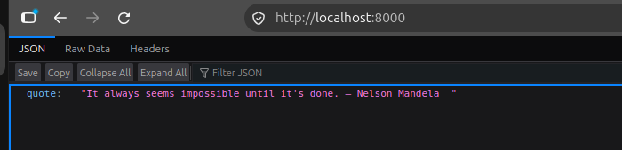
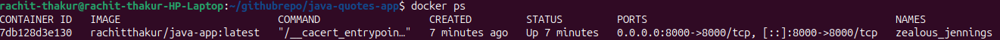
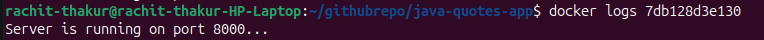
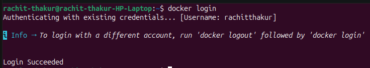
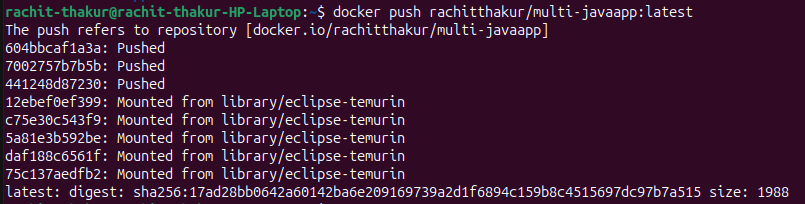
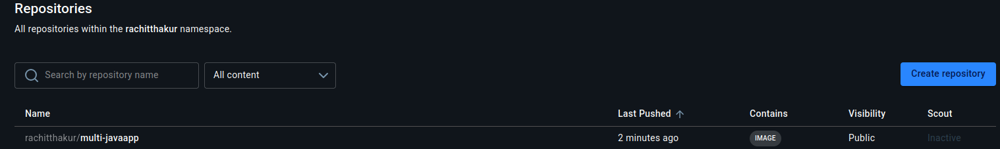
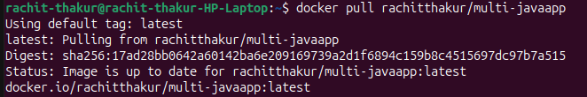
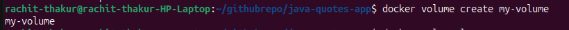
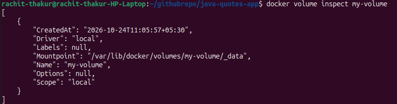
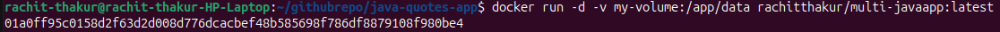

# Week 5: Docker Basics & Advanced Challenge

# Task 1: Introduction and Conceptual Understanding

- In your `solution.md`, provide a brief explanation of Docker’s purpose in modern DevOps.

---

## 1. Purpose of Docker in Modern DevOps 🐳

Docker helps applications run consistently on different computers and servers.

Imagine you develop an application on your laptop. It works perfectly, but when you run it on another computer or server, it fails because some software or dependencies are missing.

Docker solves this problem by packaging the application and everything it needs into a container.

### Why Do We Use Docker?

- **Same Environment:** The application can run consistently on your laptop, testing server, and production server.
- **Easy Deployment:** You can move and run your application on another server more easily.
- **Saves Time:** You don't need to install and configure all the application dependencies manually on every server.
- **Faster Delivery:** Docker helps DevOps teams automate application building, testing, and deployment.
- **Less Resource Usage:** Containers generally use fewer resources than virtual machines.

### Simple Real-Life Example

Imagine you pack your clothes, shoes, and other necessary items into a suitcase before travelling.

Wherever you go, you have everything you need in one place.

Docker works similarly:

- **Application:** Your clothes.
- **Dependencies:** Your shoes and other necessary items.
- **Docker Container:** Your suitcase.
- **Different Servers:** Different destinations.

You can take your suitcase to different places without collecting all your belongings again.

Similarly, Docker packages an application and its dependencies so it can run in different supported environments.

---

- Compare **Virtualization vs. Containerization** and explain why containerization is the preferred approach for microservices and CI/CD pipelines.

---

## 2. Virtualization vs. Containerization

### 2.1 What Is Virtualization?

Virtualization means creating multiple virtual computers on one physical computer.

Each virtual computer, called a **Virtual Machine (VM)**, typically has its own operating system.

**Example:**

Imagine one physical computer running three virtual machines:

- VM 1 runs Linux.
- VM 2 runs Windows.
- VM 3 runs Linux.

Each VM has its own operating system, which requires additional resources.

Think of virtualization as three separate houses, each with its own facilities.

### 2.2 What Is Containerization?

Containerization means packaging an application and everything it needs to run into a container.

Containers share the host operating system's kernel, so they generally use fewer resources than virtual machines.

**Example:**

Imagine a computer running three containers:

- Container 1 runs a Python application.
- Container 2 runs a Java application.
- Container 3 runs a Node.js application.

Each container has its own application environment, but they share the host kernel.

Think of containerization as three apartments in one building. Each apartment has its own living space, but they share the building's infrastructure.

### 2.3 Comparison: Virtualization vs. Containerization

| Virtualization | Containerization |
|---|---|
| Creates virtual computers. | Packages applications into containers. |
| Each VM typically has its own operating system. | Containers share the host OS kernel. |
| Uses more resources in many typical setups. | Generally uses fewer resources. |
| Usually takes longer to start. | Usually starts faster. |
| Useful for running different operating systems. | Useful for deploying applications quickly. |

**Conclusion:** Virtualization is useful for creating separate virtual computers, while containerization is useful for packaging and deploying applications efficiently.

---

## 3. Why Is Containerization Preferred for Microservices?

Microservices architecture means dividing a large application into smaller, independent services.

For example, an online shopping application might have:

- User Service
- Payment Service
- Product Service
- Order Service

Using containers, we can package each service separately.

### Why Is This Useful?

- **Independent Deployment:** We can update the payment service without redeploying the entire application.
- **Easy Scaling:** If the payment service receives more traffic, we can run additional instances of that service.
- **Less Resource Usage:** Containers generally require fewer resources than running a separate VM for every service.
- **Flexibility:** Different services can use different programming languages and dependencies.

### Example: Microservices Architecture

```text
          E-Commerce Application
                    |
        +-----------+-----------+
        |           |           |
        v           v           v
   User Service  Product     Payment
   Container     Container   Container
        |           |           |
        +-----------+-----------+
                    |
               Order Service
                 Container
```

**Conclusion:** Containerization is well suited to microservices because it makes individual services easier to package, deploy, and scale independently.

---

## 4. Why Is Containerization Preferred for CI/CD?

CI/CD automates the process of building, testing, and deploying applications.

Suppose a developer writes new code. A typical workflow looks like this:

### CI/CD Workflow

```text
Developer Writes Code
         |
         v
Code Is Pushed to Git
         |
         v
CI/CD Pipeline Starts
         |
         v
Docker Builds an Image
         |
         v
Application Is Tested
         |
         v
Image Is Pushed to a Registry
         |
         v
Image Is Deployed to a Server
         |
         v
Application Runs in a Container
```

### Benefits of Docker in CI/CD

- **Consistency:** The application can run consistently in testing and production.
- **Faster Deployment:** The prepared image can be deployed without reinstalling all application dependencies.
- **Easy Rollback:** If a new version fails, the team can redeploy a previous image.
- **Automation:** Tools such as Jenkins and GitHub Actions can automate building, testing, and deploying applications.
- **Portability:** The same image can be deployed across compatible environments.

### Example of Docker in CI/CD

Imagine a developer updates an application and pushes the code to GitHub.

1. GitHub Actions or Jenkins detects the code change.
2. The CI/CD pipeline builds a Docker image.
3. Automated tests check whether the application works correctly.
4. The image is pushed to a container registry.
5. The deployment process pulls the image and runs it on the target server.

This process reduces manual work and makes application delivery more consistent.

**Conclusion:** Containerization is preferred for CI/CD because it provides a consistent, portable application package that can be built, tested, and deployed through automation.

---

## 5. Final Summary

| Concept | Purpose |
|---|---|
| Docker | Packages applications and their dependencies into containers. |
| Virtualization | Creates virtual computers that typically run separate operating systems. |
| Containerization | Runs isolated applications while sharing the host OS kernel. |
| Microservices | Allows applications to be divided into smaller, independent services. |
| CI/CD | Automates application building, testing, and deployment. |

### Key Takeaway

Docker plays an important role in modern DevOps by making applications easier to package, test, deploy, and run consistently across different environments.

Containerization is particularly useful for microservices and CI/CD pipelines because it supports independent deployment, efficient resource usage, portability, and automation.

---

# Task 2: Create a Dockerfile for a Sample Java Project

This project demonstrates how to containerize a simple Java application using Docker. The application prints random quotes to the terminal and can be extended to handle web requests.

## 1. Project Overview

The goal of this project is to:

- Create a simple Java application.
- Write a Dockerfile to containerize the application.
- Build a Docker image.
- Run the application inside a Docker container.
- Verify the container status and application logs.

## 2. Project Structure

Organize your project files as follows:

```text
java-app/
├── src/
│   └── Main.java
├── Dockerfile
└── README.md
```

## 3. Create the Dockerfile

Create a file named `Dockerfile` in the root directory of your project.

```dockerfile
# Use the official Eclipse Temurin Java 21 JDK image
FROM eclipse-temurin:21-jdk

# Set the working directory
WORKDIR /app

# Copy the Java source file into the container
COPY src/Main.java .

# Compile the Java application
RUN javac Main.java

# Start the Java application
CMD ["java", "Main"]
```

### Explanation

- `FROM eclipse-temurin:21-jdk`: Uses Java 21 as the base image.
- `WORKDIR /app`: Sets `/app` as the working directory inside the container.
- `COPY src/Main.java .`: Copies the Java source file into the container.
- `RUN javac Main.java`: Compiles the Java application.
- `CMD ["java", "Main"]`: Executes the compiled Java application when the container starts.

**Note:** The Dockerfile above is suitable for a terminal-based application that prints quotes. If your application runs a web server, you must configure the application to listen on a port and expose that port as needed.

## 4. Build the Docker Image

Open a terminal in the root directory of your project and execute:

```bash
docker build -t rachitthakur/java-app:latest .
```

- `docker build`: Builds a Docker image.
- `-t rachitthakur/java-app:latest`: Assigns a name and tag to the image.
- `.`: Specifies the current directory as the build context.

### Docker Build Screenshot


## 5. Run the Docker Container

Run the application in detached mode using the following command:

```bash
docker run -d rachitthakur/java-app:latest
```

**Note:** Since this sample application prints quotes to the terminal, you do not need to map any ports. Port mapping is required only if the application runs a network service, such as a web server.

### Running Container Screenshot


The app is also running on the localhost.


## 6. Verify the Application

### Check Container Status

Execute the following command to list running containers:

```bash
docker ps
```

To view all containers, including stopped ones, use:

```bash
docker ps -a
```

### Container Status Screenshot



### Check Application Logs

View the application's output using:

```bash
docker logs <container_id>
```

The logs should display the quotes printed by the Java application.

### Docker Logs Screenshot




## 7. Stop and Remove the Container

To stop the running container:

```bash
docker stop java-app
```

To remove the container:

```bash
docker rm java-app
```

To remove the Docker image, run:

```bash
docker rmi rachitthakur/java-app:latest
```

---

# Task 3: Explore Docker Terminologies and Components

# 🐳 Docker Key Terminologies and Components

A quick guide to important **Docker concepts, components, and how they work together**.

---

## 📌 Docker Key Terminologies

### 1. Docker Image

A **Docker Image** is a read-only package containing everything required to run an application, including code, libraries, dependencies, configuration, and runtime.

```bash
docker pull nginx
```

This downloads the Nginx image from Docker Hub.

---

### 2. Docker Container

A **Docker Container** is a running instance of a Docker image. It provides an isolated environment in which an application runs.

```bash
docker run -d -p 8080:80 nginx
```

One image can be used to create multiple containers.

---

### 3. Dockerfile

A **Dockerfile** is a text file containing instructions used to build a Docker image.

Example:

```dockerfile
FROM nginx
COPY index.html /usr/share/nginx/html/
EXPOSE 80
```

Build the image:

```bash
docker build -t my-nginx .
```

---

### 4. Docker Volume

A **Docker Volume** is used to store persistent data generated or used by containers.

```bash
docker volume create mydata
```

Attach the volume to a container:

```bash
docker run -v mydata:/data nginx
```

### Uses

- Database storage
- Application data
- Persistent files
- Sharing data between containers

---

### 5. Docker Network

A **Docker Network** allows containers to communicate with each other and with external networks.

Create a network:

```bash
docker network create mynetwork
```

Run a container on the network:

```bash
docker run -d --network mynetwork --name app nginx
```

---

# 🧩 Main Docker Components

## 1. Docker Engine

**Docker Engine** is the core technology responsible for creating and managing Docker containers.

It mainly consists of:

- **Docker Daemon (`dockerd`)** – Manages images, containers, networks, and volumes.
- **Docker CLI** – Command-line interface used to interact with Docker.
- **Docker API** – Allows applications and tools to communicate with the Docker daemon.

Example:

```bash
docker run nginx
```

The Docker CLI sends the command to the Docker daemon, which creates and runs the container.

---

## 2. Docker Client

The **Docker Client** is the command-line interface through which users interact with Docker.

Common commands:

```bash
docker build
docker pull
docker run
docker ps
docker stop
```

The client communicates with the Docker daemon through the Docker API.

---

## 3. Docker Daemon

The **Docker Daemon (`dockerd`)** is a background service responsible for managing Docker objects such as:

- Images
- Containers
- Networks
- Volumes

For example:

```bash
docker run nginx
```

The daemon checks whether the Nginx image is available locally. If it is not available, Docker can download it from a registry such as Docker Hub.

---

## 4. Docker Hub

**Docker Hub** is a cloud-based registry where Docker images can be stored and shared.

Popular images include:

- Nginx
- Ubuntu
- MySQL
- Redis
- Node.js
- Python

Example:

```bash
docker pull nginx
```

---

## 5. Docker Registry

A **Docker Registry** is a storage system for Docker images.

### Types

- **Public Registry** – Images are publicly available.
- **Private Registry** – Used by organizations to store internal images.

**Docker Hub** is an example of a Docker registry.

---

## 6. Docker Compose

**Docker Compose** is used to define and run applications consisting of multiple containers.

For example:

```text
Frontend
   ↓
Backend
   ↓
Database
```

These services can be defined in a `compose.yaml` file and started together:

```bash
docker compose up
```

---

---

# 🚀 Example Docker Workflow

Suppose a developer wants to run an Nginx application.

### Step 1: Pull the Image

```bash
docker pull nginx
```

Docker downloads the Nginx image from Docker Hub if it isn't already available locally.

### Step 2: Run the Container

```bash
docker run -d -p 8080:80 nginx
```

Docker creates a container from the Nginx image.

### Step 3: Add Persistent Storage

If the application needs persistent data, attach a Docker Volume.

```bash
docker run -v mydata:/data nginx
```

### Step 4: Connect Containers

If multiple containers need to communicate, use a Docker Network.

```bash
docker network create mynetwork
```

### Step 5: Manage Containers

Useful commands include:

```bash
docker ps
docker stop <container_id>
docker start <container_id>
docker restart <container_id>
docker rm <container_id>
```

---

# 📊 Docker Terminology Summary

| Term | Description |
|---|---|
| 🖼️ **Image** | Read-only template used to create containers |
| 📦 **Container** | Running instance of an image |
| 📄 **Dockerfile** | Instructions used to build an image |
| 💾 **Volume** | Provides persistent storage |
| 🌐 **Network** | Enables communication between containers |
| ⚙️ **Docker Engine** | Core platform for running and managing containers |
| 💻 **Docker Client** | Interface used to send commands to Docker |
| 🔧 **Docker Daemon** | Background service that manages Docker resources |
| ☁️ **Docker Hub** | Cloud registry for storing and sharing images |
| 🗄️ **Registry** | System for storing Docker images |
| 🔗 **Docker Compose** | Tool for managing multi-container applications |
| 🔌 **Docker API** | Interface for communication with the Docker daemon |

---

# Task 4: Optimize Your Docker Image with Multi-Stage Builds

## 1. Implement a Multi-Stage Docker Build

A multi-stage Docker build uses multiple `FROM` statements in a single Dockerfile.

The main idea is:

- **Stage 1:** Build/compile the application using the JDK.
- **Stage 2:** Run the application using only the JRE.
- Only the required compiled files are copied from the build stage to the final image.

---

## Original Dockerfile

The original Dockerfile uses the full Java JDK for both compiling and running the application.

```dockerfile
# Use the official Eclipse Temurin Java 21 JDK image
FROM eclipse-temurin:21-jdk

# Set the working directory
WORKDIR /app

# Copy the Java source file into the container
COPY src/Main.java .

# Compile the Java application
RUN javac Main.java

# Start the Java application
CMD ["java", "Main"]
```

### Problems with the Original Dockerfile

- The full **JDK** remains in the final image.
- The Java compiler (`javac`) is not required after compilation.
- The final image can be larger than necessary.
- Development tools are included in the production container.

---

# Modified Dockerfile: Multi-Stage Build

```dockerfile
# ==========================================
# STAGE 1: Build Environment
# ==========================================

# Use the full JDK because we need the javac compiler
FROM eclipse-temurin:17-jdk-alpine AS builder

# Set the build workspace
WORKDIR /build

# Copy the Java source file
COPY src/Main.java .

# Compile the Java application
RUN javac Main.java


# ==========================================
# STAGE 2: Runtime Environment
# ==========================================

# Use only the JRE for running the application
FROM eclipse-temurin:17-jre-alpine

# Set the production workspace
WORKDIR /app

# Copy only the compiled class file from the builder stage
COPY --from=builder /build/Main.class /app/Main.class

# Copy the required text file
COPY quotes.txt /app/quotes.txt

# Document the application's port
EXPOSE 8000

# Run the Java application
CMD ["java", "Main"]
```

## How the Multi-Stage Build Works

### Stage 1 — Builder

```dockerfile
FROM eclipse-temurin:17-jdk-alpine AS builder
```

- Uses the full **JDK**.
- The JDK contains the `javac` compiler.
- Java source code is copied into the container.
- `javac Main.java` creates `Main.class`.

### Stage 2 — Runtime

```dockerfile
FROM eclipse-temurin:17-jre-alpine
```

- Uses only the **JRE**.
- The JRE contains the components required to run the Java application.
- The JDK compiler is not included.

### Copying the Compiled Application

```dockerfile
COPY --from=builder /build/Main.class /app/Main.class
```

Only the compiled `Main.class` file is copied from the builder stage.

This means the following are not carried into the final image:

- JDK compiler
- Build environment
- Temporary build files
- Original `Main.java` source file

---

# 2. Compare Image Sizes

Then check the image sizes again:

```bash
docker images
```


---

# 3. Document the Differences

## Comparison Table

| Attribute | Original Dockerfile | Multi-Stage Dockerfile | Benefit |
|---|---|---|---|
| Build Environment | Full JDK | Full JDK only in builder stage | Build tools don't remain in production |
| Runtime Environment | Full JDK | JRE Alpine | Smaller final image |
| Operating System | Standard Temurin image | Alpine-based image | Smaller footprint |
| Compiler | Present in final image | Only in builder stage | Removes unnecessary tools |
| Source Code | Present | Only compiled `.class` file copied | Cleaner final image |
| Build Files | May remain in image | Left in builder stage | Reduces unnecessary files |
| Security | More tools available | Fewer tools in final image | Smaller attack surface |
| Deployment | Larger image | Smaller image | Faster image transfer |

---

# 4. Main Benefits of Multi-Stage Builds

## 1. Smaller Docker Image 📦

- Build tools are not included in the final image.
- Only the files required to run the application are copied.
- This helps reduce the final image size.

## 2. Faster Deployment ⚡

- Smaller images require less time to upload and download.
- Containers can be deployed faster.
- This is especially useful in CI/CD pipelines.

## 3. Better Security 🔒

- Development tools such as compilers are not included in the production image.
- Fewer installed tools mean fewer potential security vulnerabilities.
- The final container has a smaller attack surface.

## 4. Separation of Build and Runtime 🏗️➡️🚀

- The **builder stage** is responsible for compiling the application.
- The **runtime stage** is responsible only for running the application.
- This creates a clean separation between development and production environments.

## 5. Less Storage Usage 💾

- Smaller images require less disk space.
- Docker registries need less storage.
- Servers require less space for storing images.

## 6. Cleaner Production Image 🧹

The final image does not need:

- Source code
- Compiler
- Build tools
- Temporary build files
- Unnecessary development dependencies

Only the required runtime files are included.

## 7. Easier Maintenance 🔧

- Build and runtime environments are clearly separated.
- The Dockerfile becomes easier to understand.
- Production images remain focused on running the application.

---

# Task 5: Manage Your Image with Docker Hub

## 1. Tag Your Image

Tag the Docker image with a version tag:

```bash
docker tag rachitthakur/multi-javaapp:latest rachitthakur/multi-javaapp:latest
```

---

## 2. Push Your Image to Docker Hub

First, log in to Docker Hub:

```bash
docker login
```



After successful login, push the Docker image to Docker Hub:

```bash
docker push rachitthakur/multi-javaapp:latest
```



### Successfully Pushed to Docker Hub

The image was successfully pushed to Docker Hub.



---

## 3. Pull the Image

To verify that the image is available on Docker Hub, pull the image:

```bash
docker pull rachitthakur/multi-javaapp:latest
```



---

## Summary

The Docker image was successfully:

- Tagged with a version tag.
- Pushed to Docker Hub.
- Verified by pulling it from Docker Hub.

The image `rachitthakur/multi-javaapp:latest` is now available on Docker Hub for use and distribution.

---

# Task 6: Persist Data with Docker Volumes

## 1. Create a Docker Volume

Create a Docker volume named `my_volume`:

```bash
docker volume create my_volume
```

### Screenshot



---

## 2. Check the Volume and Its Location

To check the details and location of the Docker volume, run:

```bash
docker volume inspect my_volume
```

This command shows information such as the volume name, driver, and mount point.

On a Linux system, the volume is usually stored under:

```text
/var/lib/docker/volumes/my_volume/_data
```

### Screenshot



---

## 3. Run a Container with the Volume

Run the Docker container and attach the `my_volume` volume to `/app/data` inside the container:

```bash
docker run -d -v my_volume:/app/data <your-username>/sample-app:v1.0
```

For example:

```bash
docker run -d -v my_volume:/app/data rachitthakur/multi-javaapp:latest
```

Here:

- `my_volume` → Docker volume
- `/app/data` → directory inside the container
- `-v` → mounts the volume to the container
- `multi-javaapp:latest` → Docker image being used

### Screenshot



---

# How Docker Volumes Help with Data Persistence

Docker containers are generally temporary. When a container is deleted, data stored only inside the container can also be lost.

Docker volumes solve this problem by storing data separately from the container.

If the container is removed, the volume and its data remain available.

A new container can use the same volume:

```bash
docker run -d -v my_volume:/app/data <your-username>/sample-app:v1.0
```

The previously stored data can then be accessed by the new container.

---

# Why Docker Volumes Are Useful

## 1. Data Persistence

Data remains available even when containers are deleted or recreated.

## 2. Container-Independent Storage

The data is stored separately from the container's lifecycle.

## 3. Easy Backup

Docker volume data can be backed up and restored when required.

## 4. Sharing Data

The same volume can be mounted to multiple containers when sharing data is required.

## 5. Useful for Databases

Docker volumes are commonly used for databases such as **MySQL** and **PostgreSQL** because database data needs to survive container restarts, upgrades, and recreation.

---

## Summary

Docker volumes provide **persistent storage** for containers. They keep application data separate from the container, allowing the data to survive when containers are stopped, removed, or recreated.

Therefore, Docker volumes are especially useful for **databases, application data, backups, and sharing data between containers**.

---