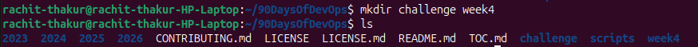
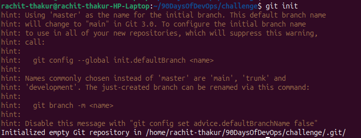
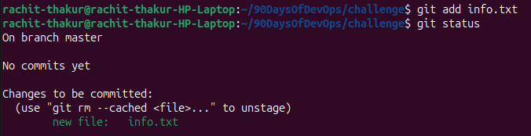
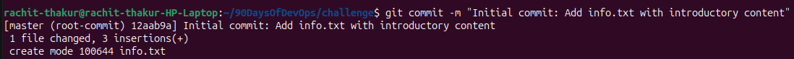

# Week 4: Git and GitHub Challenge

## **Git Basics:**

- **`git init:`** The command git init creates a new Git repository in your project folder.

   - A Git repository is where Git tracks your project's history and manages version control.\
   *Meaning:* Tell Git to start tracking your project.\
   Imagine opening a new notebook to keep a record of your project.\
    - *Example:*
    Suppose you have a project folder named my-project:

     - cd my-project\
    ```git init```

- What happens?

    Git initializes the current folder as a repository.
    Git creates a hidden .git directory to store version control information.
    Your files are not automatically added or saved in Git's history.

    - For example, your folder might look like this:

    - my-project/\
├── .git/\
├── index.html\
├── style.css\
└── script.js\

**Important:** You usually run git init only once when starting a new repository.

---

 - **`git add:`** The command git add selects the changes you want to include in your next commit.

    - This process is called staging.\
*Meaning:* Select your changes and prepare them to be saved.\
Imagine choosing which pages you want to include in your notebook.\
*Example:*
Suppose you create a file named index.html.

   - ```git add index.html```

   - This stages index.html, preparing its current contents to be included in your next commit.\
To stage all changes in the current directory and its subdirectories, use:

   - ```git add .```

   - What does staging mean?

  - Git has three important areas:

    *Working directory:* Where you create and modify files.\
    *Staging area:* Where you prepare changes for the next commit.\
    *Repository:* Where Git stores committed versions of your project.

**Important:** git add does not permanently save a version in your commit history. It only stages changes.

---
- **`git commit:`** The command git commit records the staged changes as a new version in your Git repository's history.\
  - Each commit has a unique identifier and a message describing the changes.\
*Meaning:* Save the selected changes as a version in Git's history.\
Imagine writing a note in your notebook saying, "This is my first version."\
   - *Example*

```bash 
git commit -m "Add homepage"
```

  - Let's break it down:

    *git commit:* Records the staged changes.\
    *-m:* Allows you to provide a commit message.\
    *"Add homepage":* Describes what you changed.

After this command, Git records the staged version of your files.

---

## **Repository Management:** 

- **`git clone`:** git clone is a Git command used to copy a remote repository to your local computer.

  - *Syntax*

```git clone <repository-url>```

  - *Example:*
```git clone https://github.com/username/repository.git```

- **`fork`:** A fork is a copy of someone else's repository on your own GitHub account. You can modify your copy without affecting the original repository.

**Important:** From `fork` you can copy github to github or remote to remote, but from `clone` you can copy  remote to local or github to you local.

---

## **Branching:**

- **`git branch`:** git branch is used to list all the branch in the git.

  - *Example:*

  - *main\
feature\
development

   - The * indicates the branch you are currently on.

   - To list remote branches:\
```git branch -r```

   - To list all local and remote branches:\
```git branch -a```

- **`git switch`:** The git switch command is designed specifically for switching branches.

  - Switch to an existing branch:\
```git switch main```

- **`git checkout`:** The git checkout command is an older, multifunctional command. It can switch branches, create branches, and restore files from a previous state.

  - Switch to an existing branch:\
```git checkout main```

  - Create a new branch and switch to it:\
```git checkout -b feature```

  - Switch to the previous branch:\
```git checkout -```

  - Restore a file from the current branch:\
```git checkout -- index.html```\
This last command restores index.html to its state in the index (staging area), discarding unstaged changes to that file.

---

## What is a PAT?

 - A PAT is like a password specifically created for accessing your GitHub repositories.

   - You can use it to:

      - Clone a private repository.\
      - Pull the latest changes from GitHub.\
      - Push your local commits to GitHub.\
      - Access repositories according to the token's permissions.

   - For example, your repository URL might be:

    `https://github.com/username/my-project.git`

  - When Git asks for your credentials:

    *Username:* Your GitHub username.\
    *Password:* Your Personal Access Token, not your GitHub account password.
---
## What Is a Branching Strategy?

- A branching strategy is a set of rules that a development team follows to create, manage, and merge Git branches while working on a software project.

- In Git, a branch allows developers to work on different features, bug fixes, or updates independently without directly modifying the main codebase.

   - *For example*, suppose three developers are working on the same project:

    Developer 1 is creating a login page.
    Developer 2 is developing a payment system.
    Developer 3 is fixing a bug.

- Instead of making all their changes directly to the main branch, they can create separate branches.

                 main
                  |
          -------------------
          |        |        |
       feature   feature    bugfix
        login    payment    login
          |        |        |
       Developer Developer Developer
          1        2        3

After completing their work, the developers can merge their changes into the main branch after reviewing and testing them.

---

## Why Are Branching Strategies Important?
### 1. Prevents conflicts between developers

- When multiple developers work on the same project, they may modify the same files.
Working on separate branches allows developers to make changes independently.\
  - *For example:*
```git switch -c feature-login```\
Another developer can create a different branch:\
```git switch -c feature-payment```\
- Each developer can work independently without immediately affecting the other's code.\
 
*Benefit:* Reduces interference between developers and makes conflicts easier to manage.
Note that branches do not eliminate merge conflicts; they help teams manage changes in a more organized way.
### 2. Protects the main branch

- The main branch usually contains the stable version of the project.
If every developer directly commits unfinished code to main, the application could become unstable.\
A branching strategy helps protect the main branch by requiring developers to work on separate branches and submit their changes for review.

   - *Example workflow:*

     - main\
  |
  └── feature-login\
          |
          ├── Write code\
          ├── Test code\
          ├── Review code\
          └── Merge into main

*Benefit:* Keeps the main branch stable and suitable for deployment.
### 3. Enables parallel development

- Different developers can work on different features simultaneously.

   - *For example:*

     - main/
 ├── feature-login\
 ├── feature-dashboard\
 ├── feature-payment\
 └── bugfix-navigation

- Each branch represents a separate task.
Developers can implement, test, and improve their features independently before integrating them.

*Benefit:* Saves time and helps teams develop multiple features simultaneously.
### 4. Makes code reviews easier

- Branching strategies allow teams to review changes before merging them into the main branch.
On GitHub, developers can create a Pull Request (PR) to propose changes from one branch to another.

  - For example:

    - feature-login → Pull Request → Code Review → main

- Team members can:

    - Review the code.\
    - Suggest improvements.\
    - Identify bugs.\
    - Run automated tests.\
    - Approve the changes.

*Benefit:* Improves code quality and encourages collaboration.
### 5. Simplifies bug fixing

- Suppose a production application has a critical bug.
A developer can create a separate branch to fix the problem without interfering with ongoing feature development.

   - ```git switch main```\
```git switch -c hotfix-login```

- After fixing and testing the bug, the developer can merge the changes into the appropriate branches.

*Benefit:* Allows urgent fixes to be developed and deployed more safely.

### 6. Maintains a clear development history

- Branches help teams organize their work by feature, bug fix, or release.

  - For example:

    - feature-login\
    - feature-search\
    - bugfix-payment\
    - release-v2

- Meaningful branch names help developers understand what each branch is intended to accomplish.

- Git also preserves commit history, making it easier to track changes and identify who contributed them.

*Benefit*: Improves traceability and makes project history easier to understand.

---
### Task 1: Fork and Clone the Repository
1. **Fork the Repository:** 
    - Visit [this repository](https://github.com/LondheShubham153/90DaysOfDevOps) and fork it to your own GitHub account. If not done yet.


2. **Clone Your Fork Locally:**
   - Clone the forked repository using HTTPS:
    ```bash
    git clone https://github.com/LondheShubham153/90DaysOfDevOps.git
      ```
   

   - Change directory into the cloned repository:
   ```bash
     cd 2025/git/01_Git_and_Github_Basics
     ```
     

     ---
### Task 2: Initialize a Local Repository and Create a File
1. **Set Up Your Challenge Directory:**  
   - Inside the cloned repository, create a new directory for this challenge:
     ```bash
     mkdir week-4-challenge
     cd week-4-challenge
     ```
     
2. **Initialize a Git Repository:**  
   - Initialize the directory as a new Git repository:
     ```bash
     git init
     ```
     

3. **Create a File:**  
   - Create a file named `info.txt` and add some initial content (for example, your name and a brief introduction).
   

4. **Stage and Commit Your File:**  
   - Stage the file:
     ```bash
     git add info.txt
     ```
     
   - Commit the file with a descriptive message:
     ```bash
     git commit -m "Initial commit: Add info.txt with introductory content"
     ```
     

---
