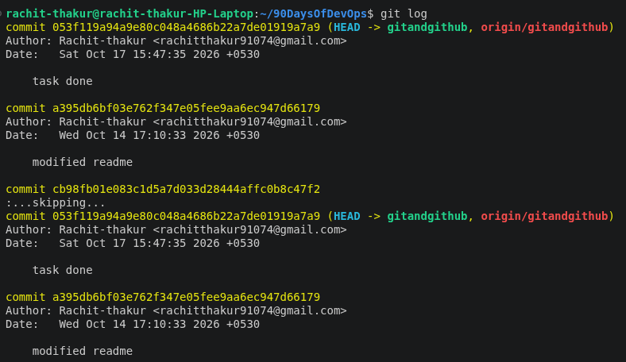
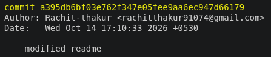

# Week 4: Git and GitHub Challenge

# Git and GitHub Basics

## 1. Git Basics

### 1.1 `git init`

The `git init` command creates a new Git repository in your project folder.

A Git repository is where Git tracks your project's history and manages version control.

**Meaning:** Tell Git to start tracking your project.

**Real-life example:** Imagine opening a new notebook to keep a record of your project.

**Example:**

Suppose you have a project folder named `my-project`.

```bash
cd my-project
git init
```

**What happens?**

- Git initializes the current folder as a repository.
- Git creates a hidden `.git` directory to store version control information.
- Your files are not automatically added or saved in Git's history.

**Example folder structure:**

```text
my-project/
├── .git/
├── index.html
├── style.css
└── script.js
```

**Important:** You usually run `git init` only once when starting a new repository.

---

### 1.2 `git add`

The `git add` command selects the changes you want to include in your next commit.

This process is called **staging**.

**Meaning:** Select your changes and prepare them to be saved.

**Real-life example:** Imagine choosing which pages you want to include in your notebook.

**Example:**

Suppose you create a file named `index.html`.

```bash
git add index.html
```

This stages `index.html`, preparing its current contents to be included in your next commit.

To stage all changes in the current directory and its subdirectories, use:

```bash
git add .
```

#### What Does Staging Mean?

Git has three important areas:

- **Working Directory:** Where you create and modify files.
- **Staging Area:** Where you prepare changes for the next commit.
- **Repository:** Where Git stores committed versions of your project.

**Important:** `git add` does not permanently save a version in your commit history. It only stages changes.

---

### 1.3 `git commit`

The `git commit` command records the staged changes as a new version in your Git repository's history.

Each commit has a unique identifier and a message describing the changes.

**Meaning:** Save the selected changes as a version in Git's history.

**Real-life example:** Imagine writing a note in your notebook saying, "This is my first version."

**Example:**

```bash
git commit -m "Add homepage"
```

**Let's break it down:**

- `git commit`: Records the staged changes.
- `-m`: Allows you to provide a commit message.
- `"Add homepage"`: Describes what you changed.

After this command, Git records the staged version of your files.

---

## 2. Repository Management

### 2.1 `git clone`

The `git clone` command copies a remote repository to your local computer.

**Syntax:**

```bash
git clone <repository-url>
```

**Example:**

```bash
git clone https://github.com/username/repository.git
```

This command downloads the repository and creates a local working copy.

### 2.2 Fork

A **fork** is a copy of someone else's repository on your own GitHub account.

You can modify your fork without directly affecting the original repository.

**Example:**

Suppose you fork a repository from another developer's GitHub account. You can make changes to your copy and later submit a Pull Request to the original repository.

#### Difference Between Fork and Clone

| Fork | Clone |
|---|---|
| Creates a copy of a repository on your GitHub account. | Creates a local copy of a repository on your computer. |
| Performed on GitHub. | Performed using Git on your computer. |
| Useful for contributing to someone else's project. | Useful for working on a repository locally. |
| Copies a repository from one remote GitHub location to another. | Copies a remote repository to your local machine. |

**Important:** Forking and cloning serve different purposes. A common workflow is to fork a repository on GitHub and then clone your fork to your local computer.

---

## 3. Branching

### 3.1 `git branch`

The `git branch` command is used to list, create, or delete branches.

To list local branches, use:

```bash
git branch
```

**Example output:**

```text
* main
  feature
  development
```

The `*` indicates the branch you are currently on.

To list remote branches:

```bash
git branch -r
```

To list all local and remote branches:

```bash
git branch -a
```

### 3.2 `git switch`

The `git switch` command is designed specifically for switching branches.

**Switch to an existing branch:**

```bash
git switch main
```

**Create a new branch and switch to it:**

```bash
git switch -c feature
```

**Switch to the previous branch:**

```bash
git switch -
```

### 3.3 `git checkout`

The `git checkout` command is an older, multifunctional command. It can switch branches, create branches, and restore files.

**Switch to an existing branch:**

```bash
git checkout main
```

**Create a new branch and switch to it:**

```bash
git checkout -b feature
```

**Switch to the previous branch:**

```bash
git checkout -
```

**Restore a file:**

```bash
git checkout -- index.html
```

This restores `index.html` to its state in the index (staging area), discarding unstaged changes to that file.

**Note:** The modern alternative for restoring files is `git restore`.

---

## 4. What Is a PAT?

A **Personal Access Token (PAT)** is a token used to authenticate with GitHub when accessing repositories and other GitHub resources.

It can be used to:

- Clone a private repository.
- Pull the latest changes from GitHub.
- Push local commits to GitHub.
- Access repositories according to the token's permissions.

**Example repository URL:**

```text
https://github.com/username/my-project.git
```

When Git prompts for credentials over HTTPS:

- **Username:** Your GitHub username.
- **Password:** Your Personal Access Token, when token-based authentication is required.

**Important:** Your GitHub account password cannot be used for Git operations over HTTPS. Keep your PAT secret and never commit it to a repository.

---

## 5. What Is a Branching Strategy?

A branching strategy is a set of rules that a development team follows to create, manage, and merge Git branches while working on a software project.

In Git, a branch allows developers to work on different features, bug fixes, or updates independently without directly modifying the main codebase.

### Example

Suppose three developers are working on the same project:

- Developer 1 is creating a login page.
- Developer 2 is developing a payment system.
- Developer 3 is fixing a bug.

Instead of making all their changes directly to the `main` branch, they can create separate branches.

**Branching structure:**

```text
                 main
                  |
          -------------------
          |        |        |
       feature   feature   bugfix
        login    payment    login
          |        |        |
       Developer Developer Developer
          1        2        3
```

After completing their work, developers can merge their changes into the `main` branch after reviewing and testing them.

---

## 6. Why Are Branching Strategies Important?

### 6.1 Prevents Conflicts Between Developers

When multiple developers work on the same project, they may modify the same files.

Working on separate branches allows developers to make changes independently.

**Example:**

Create a branch for the login feature:

```bash
git switch -c feature-login
```

Another developer can create a separate branch for the payment feature:

```bash
git switch -c feature-payment
```

Each developer can work independently without immediately affecting the other's code.

**Benefit:** Reduces interference between developers and makes conflicts easier to manage.

**Note:** Branches do not eliminate merge conflicts. They help teams manage changes in a more organized way.

### 6.2 Protects the Main Branch

The `main` branch usually contains the stable version of the project.

If every developer directly commits unfinished code to `main`, the application could become unstable.

A branching strategy helps protect the main branch by allowing developers to work on separate branches and submit their changes for review.

**Example workflow:**

```text
main
 |
 └── feature-login
         |
         ├── Write code
         ├── Test code
         ├── Review code
         └── Merge into main
```

**Benefit:** Keeps the main branch stable and suitable for deployment.

### 6.3 Enables Parallel Development

Different developers can work on different features simultaneously.

**Example:**

```text
main
 |
 ├── feature-login
 ├── feature-dashboard
 ├── feature-payment
 └── bugfix-navigation
```

Each branch represents a separate task.

Developers can implement, test, and improve their features independently before integrating them.

**Benefit:** Saves time and helps teams develop multiple features simultaneously.

### 6.4 Makes Code Reviews Easier

Branching strategies allow teams to review changes before merging them into the main branch.

On GitHub, developers can create a **Pull Request (PR)** to propose changes from one branch to another.

**Example:**

```text
feature-login
      |
      v
Pull Request
      |
      v
Code Review
      |
      v
     main
```

Team members can:

- Review the code.
- Suggest improvements.
- Identify bugs.
- Run automated tests.
- Approve the changes.

**Benefit:** Improves code quality and encourages collaboration.

### 6.5 Simplifies Bug Fixing

Suppose a production application has a critical bug.

A developer can create a separate branch to fix the problem without interfering with ongoing feature development.

**Example:**

```bash
git switch main
git switch -c hotfix-login
```

After fixing and testing the bug, the developer can merge the changes into the appropriate branches.

**Benefit:** Allows urgent fixes to be developed and deployed more safely.

### 6.6 Maintains a Clear Development History

Branches help teams organize their work by feature, bug fix, or release.

**Examples:**

- `feature-login`
- `feature-search`
- `bugfix-payment`
- `release-v2`

Meaningful branch names help developers understand what each branch is intended to accomplish.

Git also preserves commit history, making it easier to track changes and identify contributions.

**Benefit:** Improves traceability and makes project history easier to understand.

---

# Practical Tasks

## Task 1: Fork and Clone the Repository

### 1. Fork the Repository

Visit the following repository and fork it to your own GitHub account if you have not already done so.

**Repository:** [90DaysOfDevOps](https://github.com/LondheShubham153/90DaysOfDevOps)


### 2. Clone the Repository Locally

Clone the repository using HTTPS.

```bash
git clone https://github.com/LondheShubham153/90DaysOfDevOps.git
```


**Note:** If you fork the repository first, replace the URL above with the URL of your own fork to clone your copy.

Change the directory to the appropriate project folder:

```bash
cd 90DaysOfDevOps/2025/git/01_Git_and_Github_Basics
```


---

## Task 2: Initialize a Local Repository and Create a File

### 1. Set Up Your Challenge Directory

Inside the cloned repository, create a new directory for this challenge.

```bash
mkdir week-4-challenge
cd week-4-challenge
```


### 2. Initialize a Git Repository

Initialize the directory as a new Git repository.

```bash
git init
```


### 3. Create a File

Create a file named `info.txt` and add some initial content, such as your name and a brief introduction.

Example content:

```text
Name: Your Name
Introduction: I am learning Git and GitHub as part of my DevOps journey.
```

Replace `Your Name` with your own name.


### 4. Stage and Commit Your File

Stage the file:

```bash
git add info.txt
```


Commit the file with a descriptive message:

```bash
git commit -m "Initial commit: Add info.txt with introductory content"
```


---

## Task 3: Verify Your Repository Status

Check the current status of your repository:

```bash
git status
```

This command shows whether there are staged, unstaged, or untracked changes.

If all changes have been committed, Git should report that the working tree is clean.

---

## Task 4: Explore Your Commit History

### 1. View the Git Log

Check your commit history using:

```bash
git log
```



### 2. Review the Commit Details

Take note of the commit hash and other details for your documentation.



The Git log displays information such as:

- Commit hash
- Author
- Date
- Commit message

To view a shorter version of the commit history, use:

```bash
git log --oneline
```

---

## Conclusion

In this exercise, I learned the fundamentals of Git and GitHub, including repository initialization, staging, committing, cloning, forking, and branch management.

I also explored the importance of branching strategies in collaborative development and practiced creating a local repository, committing a file, and reviewing commit history.

These concepts provide a foundation for version control and collaboration in modern DevOps workflows.


