# Linux Users, Groups and Permissions

A beginner-friendly guide to understanding Linux users, groups, and file permissions, including /etc/passwd and /etc/group.

# What You'll Learn

- What Linux users are

- What Linux groups are

- Understanding /etc/passwd

- Understanding /etc/group

- Reading file permissions

- Understanding r, w, and x

- Using chmod

- Using chown


#  1. Linux Users

A user is an account that can use a Linux system, and it is able to login and run processes.
Examples:

- rahul
- ram
- root

Linix doesn't track names, thats why it assigns a unique UID (User ID).

Check the current user:

```whoami```


Check user information:

```id```

##  2. /etc/passwd

This is the file that contains basic information about users.

command to view user info:

```cat /etc/passwd```


A line may look like:

`rachit:x:1001:1001:rachit:/home/alice:/bin/bash`


The fields are separated by :.


| Field | Meaning |
| :--- | :--- |
| `rachit` | Username |
| `x` | Password placeholder |
| `1001` | UID (User ID) |
| `1001` | GID (Group ID) |
| `rachit` | User description |
| `/home/alice` | Home directory |
| `/bin/bash` | Default shell |


## TYPES OF USERS

- **Root (Superuser):** Full system control. Can install software, change config files and delete anything. Powerful but risky.
- **Regular User:** Limited access. Can create files, run applications, but not modify system-level settings.
- **Sudo User:** Regular user with temporary admin rights via the sudo command. Common in modern systems.
- **System/Service Account:** Non-human accounts used by services (e.g., mysql, nginx). Limited privileges.
- **Guest User:** Temporary users with minimal privileges. Changes are not saved after logout. (desktop     environment specific)

#  3. Linux Groups

A group is a collection of users. If you give permission to a group, all users in that group get the same access. This makes it easier to manage file and system permissions for many users at once.

For example:

- developers
- ├── rahul
- ├── ram
- └── naresh

Groups make permission management easier.

Instead of giving permissions to every user individually, you can give permissions to a group.

##  4. /etc/group

The file contains information about Linux groups.

command to list groups:

```cat /etc/group```

Example:

developers:x:1002:alice,bob

The meaning are:


| Field | Meaning |
| :--- | :--- |
| `developers` | Group name |
| `x` | Password placeholder |
| `1002` | GID (Group ID) |
| `alice,bob` | Group members |


#  5. Linux File Permissions

File permissions are core to the security model used by Linux systems. They determine who can access files and directories on a system and how. 

Linux uses three basic permissions:


| Permission | Symbol | Meaning |
| :--- | :--- | :--- |
| Read | r | Read/view |
| Write | w | Modify |
| Execute | x | Execute/access |


Permissions are assigned to three categories:

| User | Group | Others |
| :--- | :--- | :--- |
|↓     |   ↓   |      ↓ |
|rwx   |    rw-|     r--|

This will look like this in system: `drwxr-xr-x`

- **d:** `d` is directory(file type).
- **rwx:** User can read, write and execute.
- **rw-:** Groups can only read and write.
- **r--:** Others can only read.


##  6. Check File Permissions

Use:

```ls -l```


Example:

`drwxrwxr-x  9 rachit-thakur rachit-thakur     4096 Oct  1 11:38  90DaysOfDevOp`

Here:

- Owner → rachit-thakur
- Group → rachit-thakur
- Permissions → drwxrwxr-x


##  8. Changing Permissions with chmod

Chmod is used to change file permissions.
- **+:** for add permissions.
- **-:** for removeing permissions.

Add execute permission for the owner
- ```chmod u+x <file name>```

Add write permission for the group
- ```chmod g+w <file name>```

Remove read permission from others
- ```chmod o-r <file name>```

The letters mean:

- u → user/owner
- g → group
- o → others
- a → all

##  9. Numeric Permissions

Linux also allows permissions to be represented using numbers.

- Read    = 4
- Write   = 2
- Execute = 1


For example:

- 7 = 4 + 2 + 1 = rwx
- 6 = 4 + 2     = rw-
- 5 = 4 + 1     = r-x
- 4 = 4         = r--

Example
```chmod 755 <filename>```

Means:

755

- 7 → Owner  → rwx
- 5 → Group  → r-x
- 5 → Others → r-x


## 10. Changing Ownership with chown

chown changes the owner of a file.

Example:

```sudo chown new_owner filename.txt```


Change both owner and group:

```sudo chown new_owner:new_group filename.txt```

Check the result:

```ls -l filename.txt```

---

# **Task1️⃣ User & Group Management**

Create a user `devops_user` and add them to a group `devops_team`.

- create a user:
```sudo useradd devops_user```\


- create a group:
```sudo groupadd devops_team```

- add user to the group:
```sudo usermod -aG devops_team devops_user```\


Set a password and grant **sudo** access.

- set a password for the user:
```sudo passwd devops_user```\


- grant sudo access to the devops user:
```sudo usermod -aG sudo devops_user```

- verify the sudo access:
```getent group sudo | cut -d: -f4```\
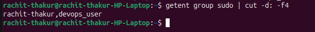

Restrict SSH login for certain users in `/etc/ssh/sshd_config`.

- restrict SSH login for certain user:
```sudo vim /etc/ssh/sshd_config```

- write in file:
`DenyUsers devops_user`

---


# **2️⃣ File & Directory Permissions**

Create `/devops_workspace` and a file `project_notes.txt`.

- create a workspace with:```mkdir devops_workspace```, and file with:```touch projectnotes.txt```
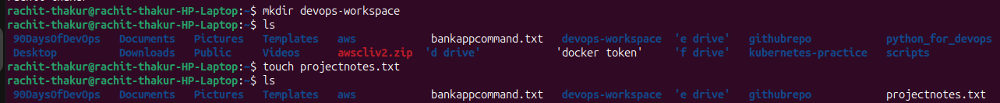

Set permissions:
**Owner can edit**, **group can read**, **others have no access**.
```chmod 240 devops-workspace projectnotes.txt```\
Use ```ls -l``` to verify permissions:\
\


---

# **3️⃣ Log File Analysis with AWK, Grep & Sed**
Logs are crucial in DevOps! You’ll analyze logs using the **Linux_2k.log** file from **LogHub** ([GitHub Repo](https://github.com/logpai/loghub/blob/master/Linux/Linux_2k.log)).

**Download the log file** from the repository.
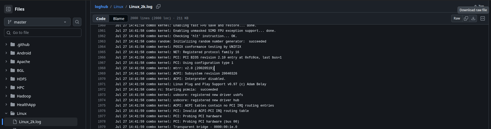

**Extract insights using commands:**
Use `grep` to find all occurrences of the word **"error"**.
```grep -i "authentication failure" Linux_2k.log```
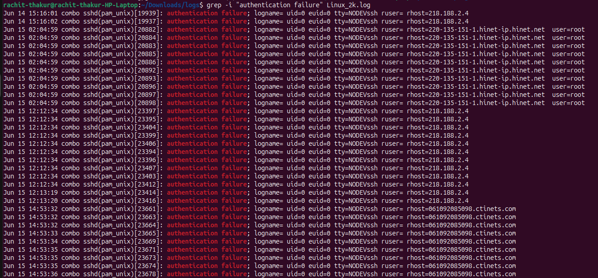
I run **"authentication failure"** commmand in **"grep"** because **"error"** is not present in log file.

Use `awk` to extract **timestamps and log levels**.\
```awk '/authentication failure/ {print $1, $2, $3, $6, $7, $12, $13}' Linux_2k.log```
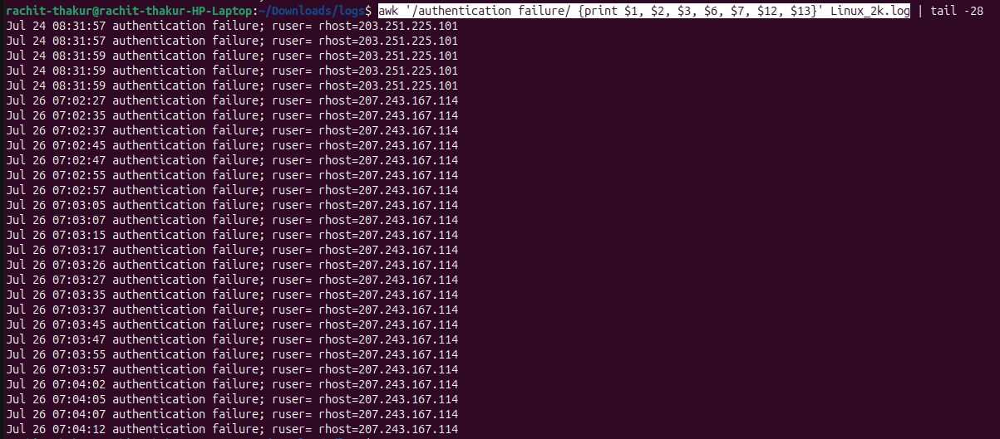

Use `sed` to replace all IP addresses with **[REDACTED]** for security.
```sed "s/rhost/REDACTED/g" authfailure.txt```
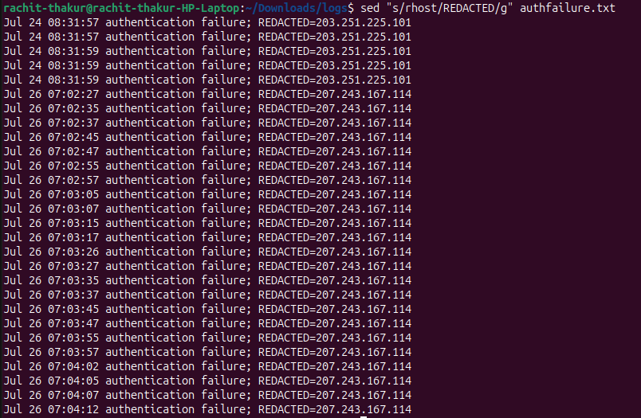

**Bonus:** Find the most frequent log entry using `awk` or `sort | uniq -c | sort -nr | head -10`.\
```sort authfailure.txt | uniq -c | sort -nr | head -10```
- **sort:** Group identical lines together.
- **uniq -c:** Collapse adjacent duplicates and prefix each line with its occurrence count.
- **sort -nr:** Sort the resulting counts numerically in reverse order (highest first).
- **head -10:** Truncate the list to show only the top 10 results.
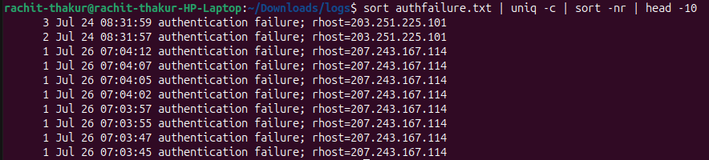


# Task 5️⃣ Process Management & Monitoring in Linux

## Objective
Learn how to start, monitor, and terminate background processes in Linux using `ps`, `top`, and `htop` commands.

## 1. Start a Background Process

Run the following command to start a ping process in the background and save its output to a log file.

```bash
ping google.com > ping_test.log &
```

**Explanation:**
- `ping google.com` – Checks network connectivity with Google.
- `>` – Redirects output to a file.
- `ping_test.log` – Stores ping output.
- `&` – Runs the process in the background.


## 2. Monitor Processes Using ps

Use the following command to find the running ping process.

```bash
ps aux | grep ping
```

**Explanation:**
- `ps` – Displays information about running processes.
- `a` – Shows processes associated with terminals.
- `u` – Displays processes in user-oriented format.
- `x` – Shows processes without a controlling terminal.
- `grep ping` – Filters output to show ping-related processes.

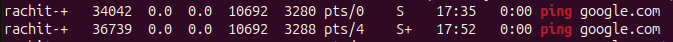

## 3. Monitor Processes Using top

Run:

```bash
top
```

**Explanation:**

The `top` command provides real-time information about system processes.

It displays:
- CPU utilization.
- Memory utilization.
- Running processes.
- Process IDs (PID).
- System load average.

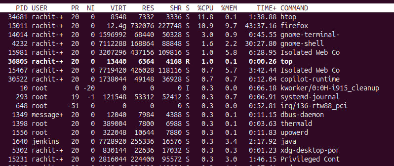

## 4. Monitor Processes Using htop

Run:

```bash
htop
```

**Explanation:**

`htop` is an interactive process monitoring tool that provides a user-friendly interface.

Features:
- Real-time CPU and memory usage.
- Interactive process management.
- Easy process searching.
- Ability to kill processes directly.

If htop is not installed, install it using:

```bash
sudo yum install htop -y
```

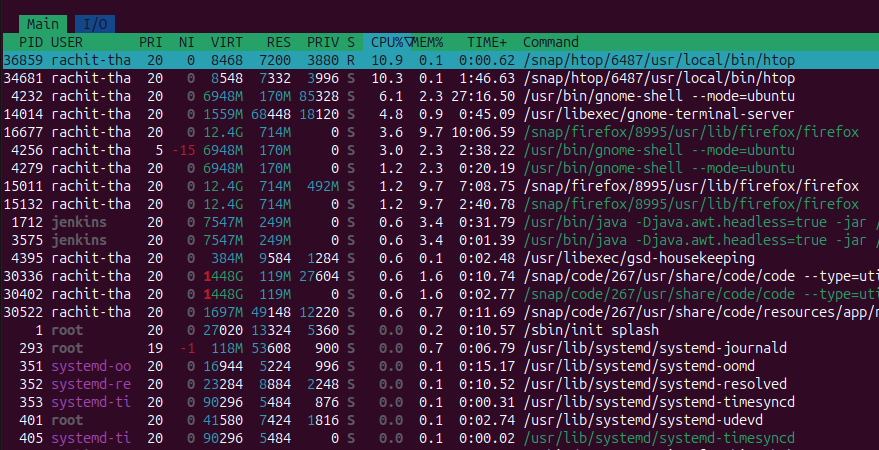

## 5. Kill the Background Process

First, identify the PID of the ping process.

```bash
ps aux | grep '[p]ing google.com'
```

Kill the process using its PID:

```bash
kill PID
```

Replace `PID` with the actual process ID.

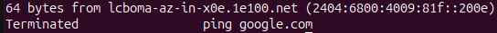

## 6. Verify Process Termination

Run the following command:

```bash
ps aux | grep '[p]ing google.com'
```

If no output appears, the ping process is no longer running.

## Conclusion

In this task, I learned how to:

1. Start a background process using `&`.
2. Redirect process output into a log file.
3. Monitor processes using `ps`.
4. Monitor CPU and memory usage using `top`.
5. Monitor processes interactively using `htop`.
6. Terminate processes using the `kill` command.
7. Verify whether a process has been terminated successfully.

**Result:** Successfully performed Linux process management and monitoring using essential Linux commands.
---

# Task 6: Automate Backups with Shell Scripting

## Objective

Automate directory backups using a Bash script and schedule them using Cron.

### Requirements
- Create a shell script to back up the `devops-workspace` directory.
- Create a compressed `.tar.gz` archive.
- Save backups inside the `backups` directory.
- Include the current date and time in the backup filename.
- Schedule automatic backups using Cron.
- Display a success message in green text.

---

## 1. Create a Backup Script

Create a file named `backup.sh`.

```bash
#!/bin/bash

# Create backup directory
mkdir -p ~/backups

# Create compressed backup
tar -czf ~/backups/backup_$(date +%F_%H-%M-%S).tar.gz -C ~ devops-workspace

# Display success message in green
echo -e "\e[32mBackup completed successfully!\e[0m"
```

## 2. Execute the Script

Give executable permission:

```bash
chmod +x backup.sh
```

Run the script manually:

```bash
./backup.sh
```

Expected output:

```text
Backup completed successfully!
```

## 3. Schedule Backup Using Cron

Open the crontab editor:

```bash
crontab -e
```

Add the following Cron job:

```bash
* * * * * /bin/bash /home/rachit-thakur/backup.sh
```

This schedules the backup script to run automatically every minute.

### Cron Schedule Explanation

| Field | Value | Description |
|---|---|---|
| Minute | `*` | Every minute |
| Hour | `*` | Every hour |
| Day | `*` | Every day |
| Month | `*` | Every month |
| Weekday | `*` | Every day of the week |

## 4. Verify the Cron Job

Check scheduled Cron jobs:

```bash
crontab -l
```

## 5. Verify Backup Files

List the backup directory:

```bash
ls -lh ~/backups/
```

Example output:

```text
backup_2026-11-06_14-50-00.tar.gz
backup_2026-11-06_14-51-00.tar.gz
backup_2026-11-06_14-52-00.tar.gz
```

## 6. Check Archive Contents

Use the following command to view files inside the compressed archive:

```bash
tar -tzf ~/backups/backup_2026-11-06_14-50-00.tar.gz
```

---

## Screenshots

### Cron Job Configuration


### Backup Files Created

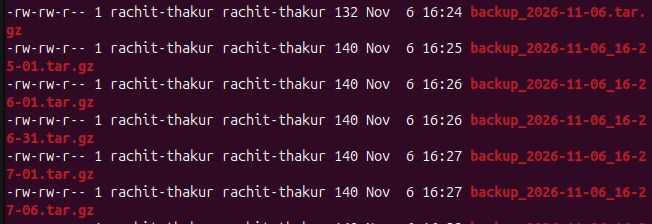

### Successful Backup Message in Green


---

## Commands Used

| Command | Purpose |
|---|---|
| `mkdir -p` | Create backup directory |
| `tar -czf` | Create compressed archive |
| `date +%F` | Get current date |
| `date +%H-%M-%S` | Get current time |
| `chmod +x` | Make script executable |
| `crontab -e` | Edit Cron jobs |
| `crontab -l` | List Cron jobs |
| `echo -e` | Display formatted text |
| `ls -lh` | List files with sizes |

## Conclusion

Successfully automated directory backups using a Bash shell script and Cron.

---