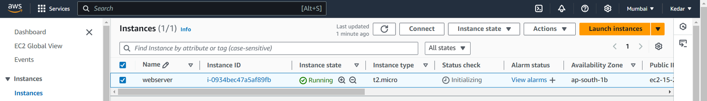

# Networking Concepts for Beginners

## Table of Contents

1. [What is Networking?](#1-what-is-networking)
2. [What is a Router?](#2-what-is-a-router)
3. [Protocols and Port Numbers](#3-protocols-and-port-numbers)
4. [Types of Network Protocols](#4-types-of-network-protocols)
   - [HTTP](#http-hypertext-transfer-protocol)
   - [HTTPS](#https-hypertext-transfer-protocol-secure)
   - [FTP](#ftp-file-transfer-protocol)
   - [SSH](#ssh-secure-shell)
   - [DNS](#dns-domain-name-system)
5. [OSI Model](#5-osi-open-systems-interconnection-model)
6. [TCP/IP Model](#6-tcpip-model)
7. [OSI vs TCP/IP Model](#7-osi-vs-tcpip-model)

---

# 1. What is Networking?

Networking is the process of connecting computers, devices, or systems so they can communicate and share information.

It is similar to how people communicate through phone calls, emails, or messages. In networking, devices such as computers, printers, servers, and mobile phones exchange data with each other.

### Examples:
- Sharing files between computers.
- Connecting computers to the internet.
- Sending emails.
- Accessing websites.
- Connecting a printer to multiple computers.

# 2. What is a Router?

A router is a networking device that forwards data packets between different networks.

It is commonly used to connect a Local Area Network (LAN) to a Wide Area Network (WAN), such as the internet.

A router receives an internet connection from an Internet Service Provider (ISP) and distributes it to multiple devices.

### Functions of a Router

- Connects different networks.
- Forwards data packets.
- Determines the best path for data transmission.
- Connects LAN to WAN.
- Supports communication between different networks.

### OSI Layer

A router primarily operates at **Layer 3 (Network Layer)** of the OSI model.

# 3. Protocols and Port Numbers

A network protocol is a set of rules that defines how data is transmitted, received, and processed between devices.

A port number identifies a specific service or application running on a device.

Port numbers range from **0 to 65535**.

### Common Network Protocols and Port Numbers

| Protocol | Port Number | Purpose |
|---|---:|---|
| HTTP | 80 | Web communication |
| HTTPS | 443 | Secure web communication |
| FTP | 20, 21 | File transfer |
| SSH | 22 | Secure remote access |
| DNS | 53 | Domain name resolution |
| Telnet | 23 | Remote terminal access |
| SMTP | 25 | Sending emails |
| POP3 | 110 | Receiving emails |
| IMAP | 143 | Email access |
| MySQL | 3306 | Database communication |
| PostgreSQL | 5432 | Database communication |
| RDP | 3389 | Remote desktop access |

**Note:** These are common default ports. Services can be configured to use different ports.

# 4. Types of Network Protocols

## HTTP (Hypertext Transfer Protocol)

**Port Number: 80**

HTTP is a protocol used to transfer web pages and data over the internet.

It defines how web browsers and web servers communicate.

### Common Uses
- Opening websites.
- Transferring web pages.
- Communicating between browsers and web servers.

## HTTPS (Hypertext Transfer Protocol Secure)

**Port Number: 443**

HTTPS is the secure version of HTTP.

It uses TLS encryption to protect communication between a browser and a web server.

### Common Uses
- Online banking.
- Online shopping.
- Secure website communication.
- Protecting sensitive information.

## FTP (File Transfer Protocol)

**Port Numbers: 20 and 21**

FTP is used to transfer files between computers over a network.

It allows users to upload and download files from an FTP server.

### Port Details

- **Port 21:** Used for the control connection.
- **Port 20:** Traditionally used for data transfer in active FTP mode.

### Common Uses
- Uploading website files.
- Downloading files from servers.
- Transferring files between systems.

## SSH (Secure Shell)

**Port Number: 22**

SSH is a secure protocol used to remotely access and manage servers.

It encrypts communication between the client and the server.

### Common Uses
- Remote login to Linux servers.
- Executing commands on remote systems.
- Secure file transfer using SFTP.
- Server administration.

Example:

```bash
ssh username@server-ip
```

## DNS (Domain Name System)

**Port Number: 53**

DNS translates human-readable domain names into IP addresses.

For example:

```text
www.google.com -> IP Address
```

When you enter a website name in your browser, DNS helps find the IP address of the server hosting that website.

### Common Uses
- Domain name resolution.
- Finding server IP addresses.
- Helping browsers access websites.

DNS commonly uses:
- UDP port 53 for standard queries.
- TCP port 53 for cases such as zone transfers and some larger responses.

---

# 5. OSI (Open Systems Interconnection) Model

The OSI model is a theoretical framework that explains how communication happens between two devices over a network.

It consists of **7 layers**. Each layer performs a specific function during network communication.

## Seven Layers of the OSI Model

| Layer | Name | Main Function |
|---:|---|---|
| 7 | Application | Provides network services to applications |
| 6 | Presentation | Data translation, encryption, and compression |
| 5 | Session | Establishes and manages communication sessions |
| 4 | Transport | End-to-end data delivery |
| 3 | Network | Logical addressing and routing |
| 2 | Data Link | MAC addressing and frame delivery |
| 1 | Physical | Transmission of raw bits |

## Layer 7: Application Layer

This layer is closest to the end user.

It provides network services to applications such as web browsers and email clients.

### Examples
- HTTP
- HTTPS
- FTP
- DNS
- SMTP

**Real-life example:** Writing a letter to a friend. You decide what information you want to communicate.

## Layer 6: Presentation Layer

This layer handles data formatting, translation, encryption, decryption, and compression.

It ensures that data is represented in a format the receiving application can understand.

### Main Functions
- Data translation.
- Encryption and decryption.
- Data compression.

**Real-life example:** Choosing the format and language of a letter so the receiver can understand it.

## Layer 5: Session Layer

This layer establishes, manages, and terminates communication sessions between applications.

### Main Functions
- Establishing sessions.
- Maintaining sessions.
- Terminating sessions.

**Real-life example:** Managing a conversation between two people, including when it starts and ends.

## Layer 4: Transport Layer

The Transport Layer provides end-to-end communication between systems.

It handles segmentation, flow control, and error recovery depending on the transport protocol.

### Main Protocols
- TCP (Transmission Control Protocol).
- UDP (User Datagram Protocol).

**Real-life example:** Sending a letter through a postal service and ensuring it reaches the correct recipient.

## Layer 3: Network Layer

The Network Layer handles logical addressing and routing.

It determines how data packets travel from the source network to the destination network.

### Main Functions
- IP addressing.
- Routing.
- Packet forwarding.

### Example
IP (Internet Protocol).

**Real-life example:** Selecting the route through which a letter travels to reach its destination.

## Layer 2: Data Link Layer

The Data Link Layer handles communication between devices on the same local network.

It uses MAC addresses and organizes data into frames.

### Main Functions
- MAC addressing.
- Framing.
- Error detection.
- Local network delivery.

**Real-life example:** Delivering a letter to the correct house within a particular neighborhood.

## Layer 1: Physical Layer

The Physical Layer is the lowest layer of the OSI model.

It deals with the physical transmission of raw bits through communication media.

### Examples
- Ethernet cables.
- Fiber-optic cables.
- Radio signals.
- Network connectors.

**Real-life example:** The physical delivery of a letter from one location to another.

---

# 6. TCP/IP Model

The TCP/IP model is a practical networking model used to describe communication over the internet.

It consists of **4 layers**, unlike the OSI model, which has 7 layers.

## Four Layers of the TCP/IP Model

| Layer | Main Function | Examples |
|---|---|---|
| Application | Provides services to applications | HTTP, HTTPS, DNS, FTP, SSH |
| Transport | End-to-end communication | TCP, UDP |
| Internet | IP addressing and routing | IP, ICMP |
| Link | Local network communication and physical transmission | Ethernet, Wi-Fi |

## Layer 1: Application Layer

This layer provides network services to end-user applications.

It combines the functions of the Application, Presentation, and Session layers of the OSI model.

### Examples
- HTTP
- HTTPS
- FTP
- DNS
- SSH
- SMTP

**Real-life example:** Using applications such as a web browser or email client to communicate over a network.

## Layer 2: Transport Layer

The Transport Layer provides communication between applications running on different devices.

Its two main protocols are TCP and UDP.

### TCP (Transmission Control Protocol)

- Connection-oriented.
- Reliable data delivery.
- Uses acknowledgements.
- Retransmits lost data.

### UDP (User Datagram Protocol)

- Connectionless.
- Faster with lower overhead.
- Does not guarantee delivery.
- Commonly used in real-time communication.

**Real-life example:** Sending information in smaller pieces and delivering it to the correct application.

## Layer 3: Internet Layer

The Internet Layer handles logical addressing and routing of packets between networks.

### Main Functions
- IP addressing.
- Packet routing.
- Packet forwarding.

### Examples
- IPv4.
- IPv6.
- ICMP.

**Real-life example:** Selecting the route through which data travels to reach another network.

## Layer 4: Link Layer

The Link Layer handles communication over the local network and the physical transmission of data.

### Examples
- Ethernet.
- Wi-Fi.

**Real-life example:** The physical or wireless connection that allows devices to communicate.

---

# 7. OSI vs TCP/IP Model

| OSI Model | TCP/IP Model |
|---|---|
| Has 7 layers | Has 4 layers |
| Reference model | Practical networking model |
| Developed by ISO | Developed through the DARPA research program |
| Application, Presentation, Session are separate | These functions are combined into Application |
| Data Link and Physical are separate | These functions are combined into Link |

### Layer Mapping

| OSI Model | TCP/IP Model |
|---|---|
| Application (Layer 7) | Application |
| Presentation (Layer 6) | Application |
| Session (Layer 5) | Application |
| Transport (Layer 4) | Transport |
| Network (Layer 3) | Internet |
| Data Link (Layer 2) | Link |
| Physical (Layer 1) | Link |

---

# Task 3: AWS EC2 and Security Groups

## 1. Launch an AWS EC2 Instance

- Launch an AWS EC2 instance using the AWS Management Console.
- A Free Tier-eligible instance can be used, depending on account eligibility and current AWS pricing.

### EC2 Instance Screenshot



---

## 2. Introduction to AWS Security Groups

An AWS Security Group is a virtual firewall that controls incoming and outgoing network traffic for AWS resources, especially EC2 instances.

It helps protect cloud instances by allowing only authorized network traffic based on configured rules.

For example:

- Allow SSH access to an EC2 instance from your IP address.
- Allow HTTP traffic so users can access a website.
- Allow HTTPS traffic for secure communication.
- Restrict database access to application servers.

Security Groups are an important part of AWS cloud security.

## 3. Importance of Security Groups

Security Groups provide several security benefits:

1. **Network Protection:** Control which traffic can reach your EC2 instances.
2. **Access Control:** Allow access only from trusted IP addresses or other security groups.
3. **Application Security:** Expose only the ports required by an application.
4. **Traffic Management:** Control inbound and outbound network communication.
5. **Centralized Management:** Apply the same security group to multiple EC2 instances.
6. **Automatic Updates:** Changes to security group rules are automatically applied to associated resources.

## 4. Types of Security Group Rules

Security Groups have two main types of rules.

### A. Inbound Rules

Inbound rules control incoming traffic to an EC2 instance.

| Type | Protocol | Port | Source | Purpose |
|---|---|---|---|---|
| SSH | TCP | 22 | My IP | Remote Linux access |
| HTTP | TCP | 80 | 0.0.0.0/0 | Website access |
| HTTPS | TCP | 443 | 0.0.0.0/0 | Secure website access |
| Custom TCP | TCP | 3306 | Application SG | MySQL database access |

### B. Outbound Rules

Outbound rules control outgoing traffic from an EC2 instance.

| Type | Protocol | Port | Destination | Purpose |
|---|---|---|---|---|
| HTTP | TCP | 80 | 0.0.0.0/0 | Access HTTP websites |
| HTTPS | TCP | 443 | 0.0.0.0/0 | Access secure websites |
| Custom TCP | TCP | 3306 | Database server | Database communication |

By default, a newly created security group allows all outbound traffic and has no inbound rules.

## 5. Important Characteristics of Security Groups

1. Security Groups are stateful.
2. They support allow rules, not deny rules.
3. All inbound traffic is denied by default when a security group is created.
4. Outbound traffic is allowed by default through the initial outbound rule.
5. Multiple security groups can be attached to an EC2 instance.
6. Rules from multiple attached security groups are combined.
7. Changes to rules are automatically applied to associated resources.
8. Security Groups operate at the resource or network-interface level.

### What Does Stateful Mean?

Stateful means that if an EC2 instance receives an allowed request, its response traffic is automatically allowed.

Similarly, if an EC2 instance sends a request, the response traffic is automatically allowed back in.

You do not need to create separate rules for the response traffic.

---

# 6. Step-by-Step Guide to Create a Security Group

We will create a Security Group for an AWS EC2 web server.

### Step 1: Login to AWS Console

1. Open the AWS Management Console.
2. Sign in using your AWS account.
3. Search for EC2 in the AWS services search bar.
4. Open the EC2 Dashboard.

### Step 2: Open Security Groups

1. In the EC2 Dashboard, find the Network & Security section.
2. Click on Security Groups.
3. Click the **Create security group** button.

### Step 3: Configure Basic Details

Enter the following information:

| Field | Value |
|---|---|
| Security Group Name | Web-Server-SG |
| Description | Security group for web server |
| VPC | Select your required VPC |

A VPC is a logically isolated virtual network where you launch AWS resources.

### Step 4: Configure Inbound Rules

Add the following inbound rules:

| Type | Protocol | Port Range | Source |
|---|---|---|---|
| SSH | TCP | 22 | My IP |
| HTTP | TCP | 80 | Anywhere IPv4 |
| HTTPS | TCP | 443 | Anywhere IPv4 |

**Explanation:**

- **SSH (22):** Allows administrators to connect to the Linux instance.
- **HTTP (80):** Allows users to access the website.
- **HTTPS (443):** Allows secure website communication.

**Security Note:** Avoid allowing SSH access from `0.0.0.0/0` in production. Restrict it to your trusted IP address or network.

### Step 5: Configure Outbound Rules

You can keep the default outbound rule:

| Type | Protocol | Port | Destination |
|---|---|---|---|
| All Traffic | All | All | 0.0.0.0/0 |

This allows the EC2 instance to send traffic to any IPv4 destination.

For better security, you can restrict outbound traffic to only the destinations and ports your application requires.

### Step 6: Add Tags (Optional)

You can add tags to identify and organize your Security Group.

Example:

| Key | Value |
|---|---|
| Environment | Production |
| Project | Web-Application |

### Step 7: Create Security Group

1. Review the inbound and outbound rules.
2. Click **Create security group**.
3. Your Security Group will now be created.

---

## 7. Attach Security Group to an EC2 Instance

After creating the Security Group:

1. Open the EC2 Dashboard.
2. Click Instances.
3. Select the EC2 instance.
4. Choose Actions.
5. Select Security.
6. Click Change security groups.
7. Select Web-Server-SG.
8. Click Add security group if required.
9. Click Save.

Your EC2 instance is now associated with the Security Group.

## 8. Modify Security Group Rules

You can modify rules whenever your application requirements change.

Steps:

1. Open EC2 Dashboard.
2. Navigate to Security Groups.
3. Select the Security Group.
4. Open the Inbound rules or Outbound rules tab.
5. Click Edit inbound rules or Edit outbound rules.
6. Add, modify, or remove rules.
7. Click Save rules.

Changes are automatically applied to the associated resources.

---

## 9. Security Group Best Practices

1. Follow the principle of least privilege.
2. Allow only the ports required by your application.
3. Restrict SSH access to trusted IP addresses.
4. Never expose database ports directly to the public internet.
5. Use Security Group references for communication between application tiers.
6. Avoid opening unnecessary port ranges.
7. Regularly review and remove unused rules.
8. Use meaningful names and descriptions.
9. Keep production and development environments separate.
10. Use IAM permissions to control who can create and modify Security Groups.

---

## 10. Official AWS Documentation

- [Create a Security Group](https://docs.aws.amazon.com/AWSEC2/latest/UserGuide/creating-security-group.html)
- [Security Group Rules](https://docs.aws.amazon.com/vpc/latest/userguide/security-group-rules.html)
- [EC2 Security Groups](https://docs.aws.amazon.com/AWSEC2/latest/UserGuide/ec2-security-groups.html)
### Important Commands for Practice

```bash
# Check IP address
ip addr

# Check routing table
ip route

# Check network connectivity
ping google.com

# Check DNS resolution
nslookup google.com

# Check listening ports
sudo ss -tulnp

# Test a specific port
telnet server-ip 8080

# Test HTTP connectivity
curl http://server-ip:8080

# Check network interfaces
ip link
```
